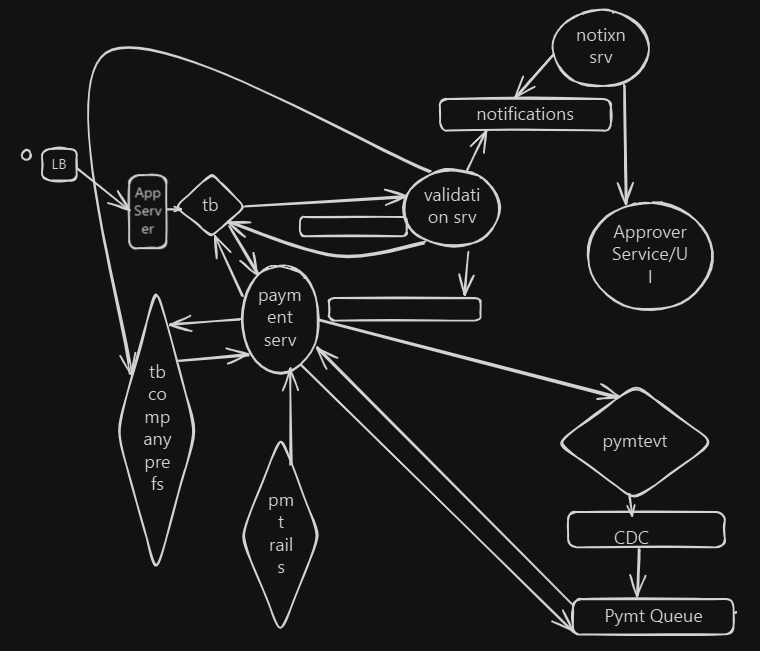

# Take-Home Exercise

In the previous round, we discussed a high‑level system design functionality.
For this exercise, we’d like you to translate that design into code.

Your design for reference:



Your other notes:
```
Nouns

Company
Contractor/Payee
Invoice
Payment

**How Invoices are captured.
Functional
Single + Batch payments
Correctness
Avoid duplicate payments/trxns
Data Isolation between Companies/Payees
Ability to view details of payments
Transaction statement


Non-functional
Number of payments = Throughput = 30,000 payments per day
Number of users= 100,000 Users
Latency of a single payment 
Availability (Up time) 5 9s of avail
```

## The Ask
Using the system design you proposed earlier (or an evolved version of it):

Implement a minimal but coherent slice of the system in code
Focus on turning architectural ideas into concrete:

- APIs
- core domain models
- Basic workflows

The goal is not completeness, but to demonstrate how you move from design → implementation.

The structure is intentionally minimal, you’re encouraged to shape the solution in a way that reflects how you typically work on production systems.

## Time Expectation

- **Expected:** ~1–2 hours  
- **Upper bound:** No more than **4 hours**

We respect your time. We’ll review the time spent based on your **git commit history**, so please commit as you work rather than batching everything at the end.


## Starting the Exercise

### Initial Commit (Required)

Please make an **initial commit shortly after you begin**.  
This should be small but meaningful — for example:
- Updating this README with an outline or assumptions
- Adding brief design notes
- Establishing a minimal project skeleton

This helps us understand your starting point and how you approach the problem.


## Expectations & Constraints

- **Commits**
  - Commit early and incrementally
  - Clear intent matters more than polish

- **Technology**
  - **C#**
  - **.NET 8 or newer** (9/10 welcome)

- **AI Tools**
  - AI usage is **required / expected**
  - Please include the **full conversation transcript** of any AI interaction(s) in the repo (for example, `AI-TRANSCRIPT.md`)
  - Transparency is required; AI usage itself is not evaluated negatively


## Required Artifacts

Please include the following:

1. **Design Notes**
   - A short document describing:
     - Key design decisions
     - Trade-offs considered
     - What you intentionally scoped out and why
   - Format is up to you (e.g. `DESIGN.md`)

2. **Run Instructions**
   - Clear steps to build and run the project locally
   - Can live in this README or a separate document

3. **Full conversation transcript** of any AI interaction(s)
   - Create a file, e.g. `AI-TRANSCRIPT.md`

## What We Value

- Sound engineering judgment
- Clear reasoning and trade-off awareness
- Readable, testable and maintainable code
- Meaningful test coverage for the implemented code paths
- Pragmatic scope decisions

There is no “perfect” solution. We’re interested in **how you think, how you structure work, and how you communicate decisions**.


## Ambiguity

If something is unclear, make a reasonable assumption and document it. That is part of the exercise.

Once complete, ensure your final state is pushed to this repository.
